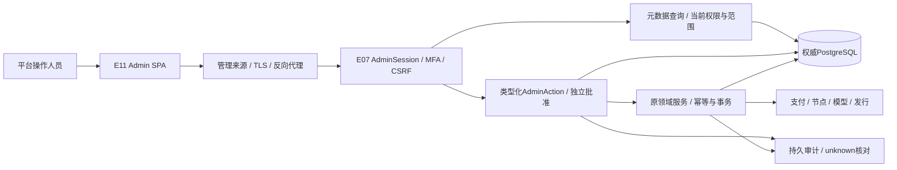

# 技术架构与状态归属

E11是独立SPA与独立Git仓库的规划，使用管理专用来源。管理API仍由E07 Rust控制面提供；无需增加Node BFF或独立管理数据库。所有服务部署/身份/网络均待真实环境确认。

## 运行拓扑



页面提交和批准仅产生对应事实，不能据HTTP成功把财务、GPU或外部效果一并标完成。服务端响应是最终权威，浏览器投影只展示当前已知状态。

## 前端模块

| 模块 | 职责 | 依赖约束 |
|---|---|---|
| app/router/layout | 启动、路由、导航、环境/范围选择、错误边界 | 初始化会话后才加载敏感页面 |
| auth/session | 管理身份、权限/范围、step-up状态和退出 | 不存IdP/provider明文token，调用E07会话接口 |
| api-client/contracts | 类型化请求、错误、幂等、ETag、schema版本 | 只消费服务端固定契约，不接受任意API路径执行 |
| resources | 用户/组织、Run/工作区、节点/模型、账务/风险/发行等只读投影 | 分页和字段ACL来自后端，UI不得拼接全库数据绕过限额 |
| actions/approvals | 17种动作表单、不可变预览、批准/执行/核对 | 不自行决定required_approvals或风险等级 |
| audit/support | 审计、对账case、SupportGrant与限时内容查询 | 敏感内容独立内存状态，不写持久前端缓存 |
| shared-ui | 金额/时间/状态、表单、分页、操作反馈 | 只含通用展示，不内置特权政策或凭证 |

将页面读模型与动作命令分开。页面不直接拼HTTP和策略；API客户端不决定授权；角色显示与后端policy使用相同permission名称，但允许/拒绝仍由后端判定。

## 关键数据流

查询：读取AdminSession→选择已授权environment/scope→取得资源列表/详情→渲染版本与更新时间。切换scope、退出或会话代际变化清理旧缓存并取消旧请求，迟到响应不能写入新会话。

操作：选择目标及当前版本→填写类型化payload、原因和工单→创建AdminAction→显示服务端摘要/政策→不同主体批准→使用当前ETag执行→轮询同一action和业务记录。网络超时后进入“结果待核对”，查询原ID，不能自动换键提交。

支持访问：先取得用户授权引用和独立批准→产生有限SupportGrant→每次读取重新鉴权和审计→过期/撤销停止新取回。凭证、支付密钥、签名私钥不属于内容授权范围。

## 代码目录规划

```text
orange-agent-admin/
├── README.md
├── docs/                      # 当前已落位文档与契约快照
├── apps/admin/                # 未来E11唯一应用package
│   ├── src/app/
│   ├── src/auth/
│   ├── src/api/
│   ├── src/features/
│   ├── src/shared/
│   └── tests/
├── tests/                     # 跨版本契约/浏览器夹具
└── deploy/                    # 静态资源/反向代理/发布配置
```

除文档外的目录与清单是未来设计，尚未生成。独立仓库不意味着独立领域服务；共享UI需要时以固定版本包消费，不依赖相邻用户Web仓库的源码路径。

## 故障边界

无权限/过期会话停止相关请求；资源版本冲突要求重新读取和重新确认；后台不可用不降级成本地“管理员模式”。UI崩溃、页面刷新和静态资源回退不能删除服务器审批、冻结或unknown记录。恢复时先查询持久业务状态。
